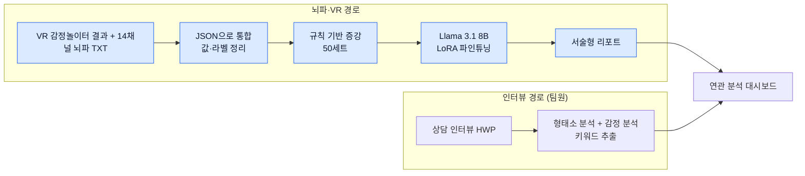
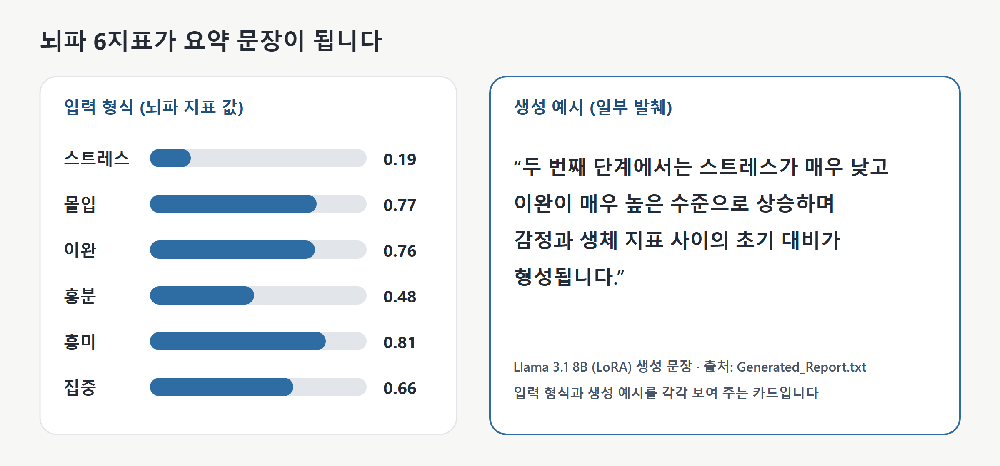

# Emori

**VR 체험 중 측정한 뇌파 데이터와 상담 인터뷰 텍스트를 함께 분석해, 상담자가 학생의 상태를 빠르게 파악하도록 돕는 멀티모달 AI 프로젝트**

[](./config/Emotion_EEG/Library/library_ver.txt) [](./src/Emotion_EEG/DescriptiveSummary_Llama3/Llama3.py) [-7C3AED?style=flat-square)](./output/Emotion_EEG/Llama3_Result/adapter_config.json)

> [!NOTE]
> 2025학년도 2학기 산학협력프로젝트(협력기관 (주)모티버, 2025.09 ~ 12) **팀 프로젝트**입니다.
> 저는 **뇌파 데이터 전처리**와 **Llama 3.1 8B 파인튜닝**을 맡았고, 이 README는 제 담당 부분을 중심으로 설명합니다.

## 🧭 개요

협력 기업은 VR 감정놀이터라는 프로그램으로 학생의 감정과 뇌파를 수집합니다. 상담 현장에는 두 가지 비효율이 있었습니다.

- 상담 전문가가 솔루션이 만든 **리포트를 보고 다시 해석**해야 했습니다.
- 상담 내용은 녹음되지만 **텍스트로만 저장**되어, 이것도 따로 분석해야 했습니다.

Emori는 이 두 단계를 AI로 줄입니다. 뇌파·VR 데이터는 **읽기 쉬운 서술형 리포트**로 바꾸고, 인터뷰 텍스트는 **감정 키워드**로 정리한 뒤 둘을 한 화면에서 함께 보여 줍니다. 말로는 "괜찮다"고 해도 몸은 긴장하고 있는 경우처럼, 말과 몸의 신호가 어긋나는 지점을 찾는 데 도움을 주려는 목적입니다.

## 🙋 나의 역할

| 구분 | 영역 | 내용 |
| :---: | :--- | :--- |
| 🙋 **나** | 뇌파 전처리 | 뇌파·VR 결과 TXT를 JSON으로 통합, 값·라벨 정리 |
| 🙋 **나** | 학습 데이터 | 규칙 기반 증강 50세트, 정답 문장 4문체 작성 |
| 🙋 **나** | 모델 | Llama 3.1 8B LoRA 파인튜닝, 서술형 요약 생성 |
| 👥 팀원 | 인터뷰 분석 | 상담 텍스트의 감정 키워드 추출 |
| 👥 팀원 | 연관 분석 | 키워드·감정 연관 분석, 통합 대시보드 |

🏆 2025 한국정보기술학회 추계종합학술대회에서 이 프로젝트의 논문이 **우수논문상(동상)**을 받았습니다(팀 논문).

## 🏗️ 시스템 구성

두 갈래 입력을 각각 분석한 뒤 합칩니다. 파란색이 제가 맡은 구간입니다.



- 뇌파 경로는 eMotiv 장비의 뇌파 값(스트레스, 몰입, 이완, 흥분, 흥미, 집중)과 VR 감정 결과를 한 JSON으로 합쳐 모델 입력으로 씁니다.
- 인터뷰 경로는 팀원이 맡았고, 논문에서는 형태소 분석(Mecab)과 BERT를 결합한 감정 키워드 추출로 설명합니다.

## 🔧 핵심 설계 결정

각 결정을 **문제 → 분석(대안 비교) → 선택 → 결과** 순서로 정리했습니다.

### 🧠 1. 서술형 요약에 LLM 파인튜닝을 쓴 이유

- **문제:** 뇌파 지표는 수치라서 상담자가 바로 읽기 어렵습니다. 협력 기업과 협의해 "주어진 데이터를 전처리한 결과를 바탕으로 AI가 정해진 형식에 가까운 서술형 답변을 한다"는 방향으로 정했습니다.
- **분석:** 규칙 기반 템플릿은 문장이 반복적이고 기계적이며, "스트레스가 높으면 높음"처럼 지표 하나씩만 해석합니다. 반대로 LLM을 그대로 호출하면 도메인 표현이 부족하고 일반적인 말만 합니다. 학습에 쓸 수 있는 데이터도 100개 이하로 적었습니다.
- **선택:** 파인튜닝에 데이터 증강과 여러 문체의 정답 문장을 결합했습니다.
- ✅ **결과:** 여러 지표가 함께 움직이는 패턴을 한 문장으로 서술하는 요약이 생성됩니다(아래 결과 예시 참고). 정량 평가는 하지 않았습니다(한계 항목 참고).

### 🧪 2. 데이터를 증강한 방법

- **문제:** 제공받은 데이터가 학생 데이터라 양이 적습니다.
- **분석:** 단순 무작위로 만들면 스트레스와 이완이 함께 높은 식의 비현실적인 조합이 생깁니다. 러셀의 감정 이론처럼 정서 쪽 이론을 처음 공부하며 참고해, 규칙을 직접 정했습니다.
- **선택:** 처음 9세트는 제공받은 기록의 흐름을 유지하고, 나머지는 ±20% 범위에서 생성했습니다. 스트레스는 이완의 반대 방향으로 만들고, 서로 어긋나는 극단 조합의 빈도는 제한했습니다. 시드를 고정해 재현할 수 있습니다([코드](./src/Emotion_EEG/DataAugmentation/DataAugmentation.py)).
- ✅ **결과:** 50세트를 생성했고, 감정 종류와 강도 값은 모두 단어표에 있는 값입니다. 다만 실제 사람 데이터와 얼마나 비슷한지는 검증하지 못했습니다.

### 🏷️ 3. 정답 문장을 4가지 문체로 쓴 이유

- **문제:** LLM이 항상 같은 말만 하면 리포트가 단조롭고, 학습 데이터 양도 부족합니다.
- **분석:** 같은 입력에도 여러 관점의 정답을 주면 표현이 다양해지고, 학습 데이터도 늘릴 수 있다고 판단했습니다.
- **선택:** 한 입력에 4가지 기준으로 정답을 작성했습니다([기준](./config/Emotion_EEG/Llama3_Assistant_Rule/Assistant_Rule.txt)): 상반된 지표 강조, 긍정 결과 강조, 흐름과 전문 어휘 강조, 단순 나열.
- ✅ **결과:** 70세트 × 4문체 = 280개를 만들었습니다([라벨](./data/Emotion_EEG/Llama3_Assistant_Data/Manual_Assistant_Labels.csv)).

### ✂️ 4. 단순 나열 문체를 학습에서 뺀 이유

- **문제:** 4번째 문체의 답변이 너무 형식적이었습니다.
- **분석:** 생성 결과를 읽어 보고 부자연스럽다고 판단했습니다. 정량 비교가 아니라 직접 읽고 내린 판단입니다.
- **선택:** 단순 나열을 제외하고(280개 → 210개), 학습 80% : 검증 20%로 나눠 에폭마다 검증했습니다. 에폭은 10에서 7로 줄였습니다("7로도 충분하다"는 커밋 메모 기준이며 비교 수치는 남아 있지 않습니다).
- ✅ **결과:** 학습 168개, 검증 42개로 학습합니다([코드](./src/Emotion_EEG/DescriptiveSummary_Llama3/Llama3.py)).

### 🔤 5. 값 이름 통일

- **문제:** 감정 강도가 코드에서는 `Full / Half / Low`, 원본에서는 `Highest / High / Low / Least`였고 `Disgust`도 원본에서는 `Dislike`였습니다.
- **선택:** 원본 값을 기준으로 단어표와 증강 코드를 함께 고치고 증강 JSON을 다시 만들었습니다.
- ✅ **결과:** 증강 50세트의 감정과 강도 값이 모두 단어표에 있는 값입니다.

## 📊 결과

뇌파 지표 입력 형식과 생성된 요약의 예시입니다. 입력 형식과 생성 문장은 각각 저장소 파일에서 발췌한 것입니다.

<p align="center">
<picture>
  <source media="(prefers-color-scheme: dark)" srcset="./docs/assets/result-card.dark.png">
  
</picture>
</p>

생성된 리포트는 3단계(체험의 시작, 중간, 마지막)를 각각 한 문장씩 서술합니다. 전체 예시는 [`Generated_Report.txt`](./output/Emotion_EEG/Llama3_Result/Generated_Report.txt)에 있습니다.

## ⚠️ 한계

- 파인튜닝 결과의 **정량 평가**(정확도, 손실 곡선 비교 등)를 하지 않았습니다. 품질은 생성 문장을 직접 읽고 확인한 수준입니다.
- 학습 데이터는 소규모 실제 기록과 규칙 기반 증강본이 섞여 있어, 실제 학생 분포와의 유사도는 검증하지 못했습니다.
- 증강에 쓴 감정 단어 대응에는 임의로 정한 값이 포함되어 있어, 협력 기업의 실제 표준값 확인이 필요합니다.
- 자동 테스트와 CI는 없습니다.

## 🧱 기술 스택

| 구분 | 사용 기술 |
| :--- | :--- |
| 언어 | Python 3.11 |
| 모델 | Meta Llama 3.1 8B Instruct (4비트 NF4 양자화) |
| 학습 | Transformers, TRL(SFT), PEFT(LoRA), bitsandbytes |
| 데이터 | JSON, JSONL, pandas, numpy |

LoRA 설정은 r=32, alpha=16, dropout=0.1이고 대상은 `q_proj`, `v_proj`입니다. 학습은 에폭 7, 배치 1 × 누적 8, 학습률 3e-4(cosine)로 했습니다. 개인 PC(NVIDIA RTX 4070 Ti)에서 4비트 양자화와 LoRA로 학습했습니다.

## 📂 프로젝트 구조

제가 작성한 부분입니다.

```text
src/Emotion_EEG/
├── TxtToJson/                  # 뇌파·VR 결과 TXT를 JSON으로 통합
├── KeyWord/                    # 감정 단어표
├── DataAugmentation/           # 규칙 기반 증강
├── JsonToJsonl/                # 학습·추론용 JSONL 변환
├── DescriptiveSummary_Llama3/  # LoRA 학습(Llama3.py), 추론(Llama3Main.py)
└── Run/run_pipeline.py         # 변환부터 요약 생성까지 이어서 실행
data/Emotion_EEG/Llama3_Assistant_Data/   # 정답 문장 라벨(CSV)
config/Emotion_EEG/                       # 문체 기준, 라이브러리 버전
output/Emotion_EEG/                       # 증강 JSON, JSONL, LoRA 어댑터, 생성 결과
```

## 🚀 시작하기

학습에는 CUDA 환경의 GPU와 Hugging Face의 Llama 3.1 모델 접근 승인이 필요합니다. 라이브러리 버전과 설정 절차는 [`library_ver.txt`](./config/Emotion_EEG/Library/library_ver.txt)에 있습니다. 원본 뇌파 TXT에는 참가자 정보가 들어 있어 별도로 관리해야 합니다.

```bash
pip install -r requirements.txt   # 그리고 library_ver.txt의 학습용 라이브러리·PyTorch(CUDA) 설치

# 저장소 루트에서 실행
python src/Emotion_EEG/DataAugmentation/DataAugmentation.py   # 증강 50세트
python src/Emotion_EEG/JsonToJsonl/JsonToJsonL.py             # 학습용 JSONL
python src/Emotion_EEG/DescriptiveSummary_Llama3/Llama3.py    # LoRA 학습
python src/Emotion_EEG/Run/run_pipeline.py                    # 변환부터 요약 생성
```

## 🤖 개발 과정에서의 AI 활용

AI 도구는 아이디어를 정리하고, 처음 접한 정서 이론을 이해하고, 코드를 쓰는 데 사용했습니다. **학습 설정과 결과의 확인은 직접 했습니다.**

| AI에 맡긴 일 | 직접 한 일 |
| :--- | :--- |
| 코드 작성 | 증강 규칙 정하기(러셀의 감정 이론 등을 참고) |
| 아이디어 정리 | 정답 문장의 4가지 문체 설계와 작성 |
| 정서 이론 같은 도메인 개념 학습 보조 | 학습 설정·수치 확인, 생성된 문장을 읽고 검증 |

## 📚 참고

- 논문: 김도현, 김태형, 신현우, 바트바야르뭉흐밧, 황성원, 김재수, 「정서, 뇌파데이터와 상담 텍스트의 다중 모달 연관 분석 기반 심리 상태 진단 시스템」, 2025 한국정보기술학회 추계종합학술대회.
- 이 프로젝트는 [dozzzang/Emori](https://github.com/dozzzang/Emori)를 fork한 저장소입니다.
